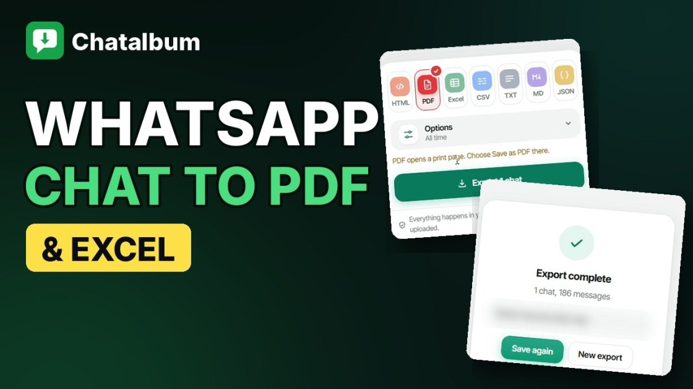
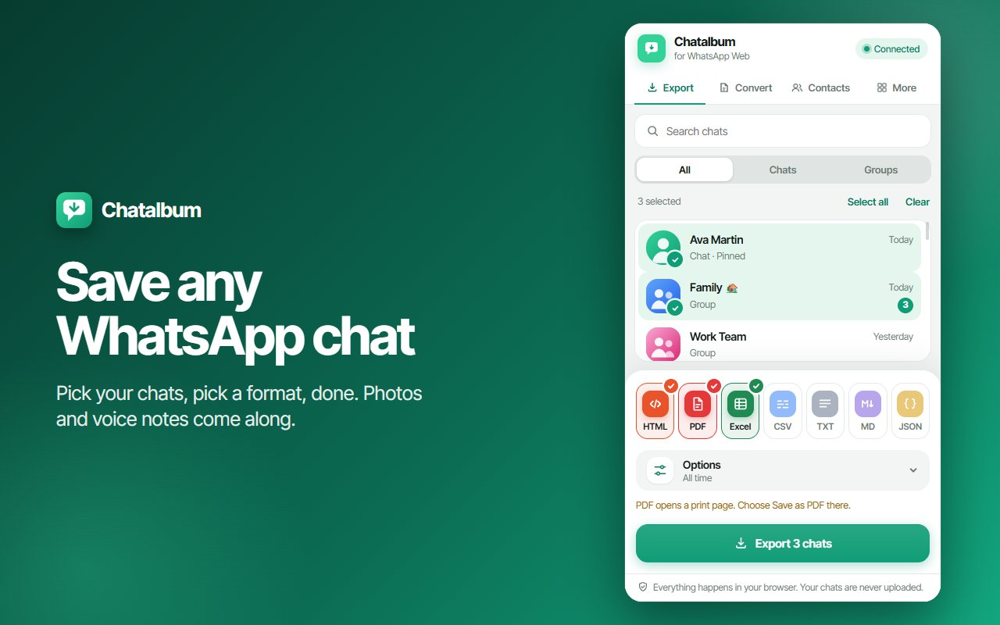
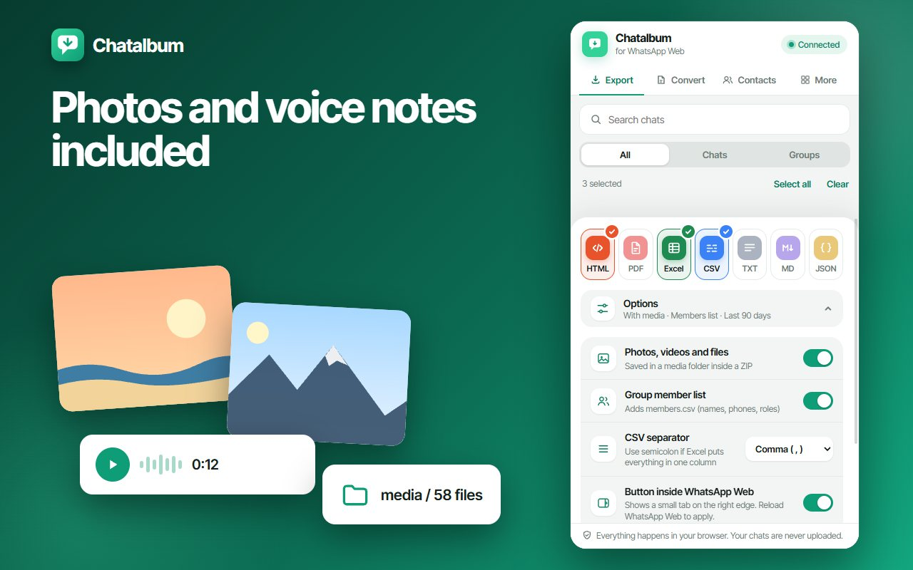
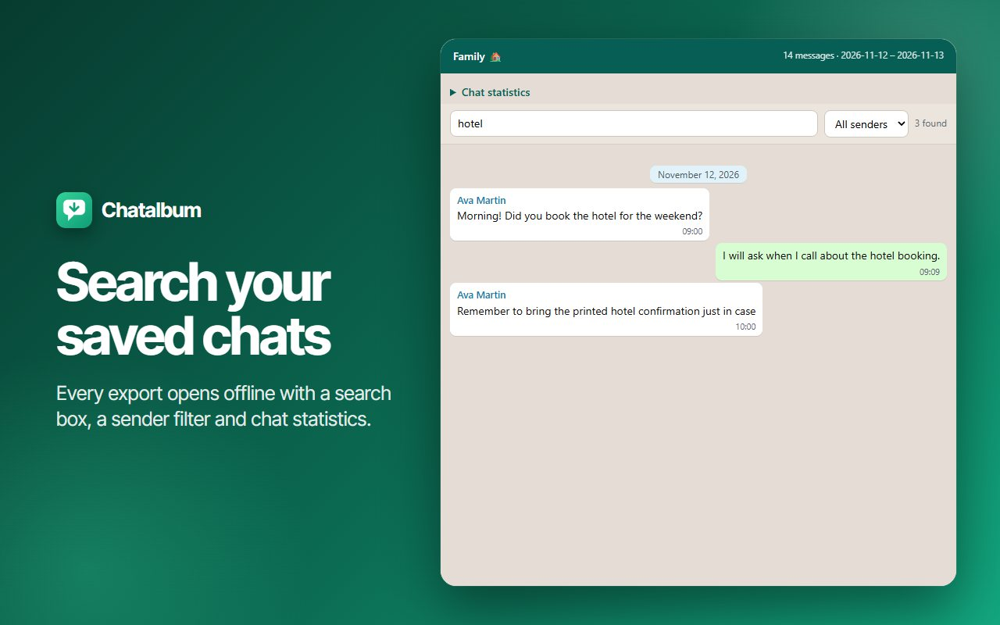
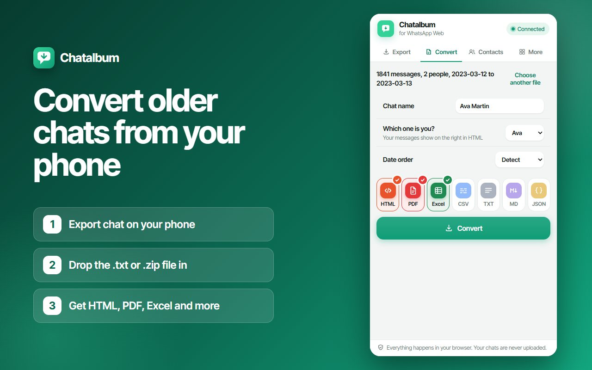
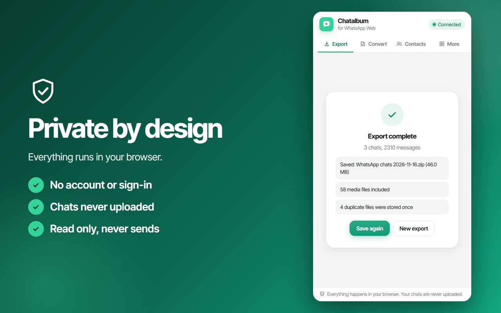

# Chatalbum - WhatsApp Chat Export to PDF & Excel

Chatalbum is a Chrome extension that saves WhatsApp Web chats as files on your own computer: PDF, Excel, a searchable HTML album, CSV, TXT, Markdown, JSON, vCard or a ZIP with the photos, videos and voice notes. It only reads chats. It never sends, edits or deletes a message, and nothing is uploaded.

<a href="https://chromewebstore.google.com/detail/gbpfhimobpomfdjacclpidchpidnjabh?utm_source=github&utm_medium=readme&utm_campaign=chatalbum">Chrome Web Store</a> |
<a href="https://www.addonschrome.com/extensions/chatalbum-whatsapp-chat-export-to-pdf-excel.html?utm_source=github&utm_medium=readme&utm_campaign=chatalbum">Full guide and FAQ</a> |
<a href="https://www.youtube.com/watch?v=r5zGHKsmVJk">Video demo</a>

This repository is the public home for Chatalbum's documentation, release notes and issue tracker. The extension itself is distributed through the Chrome Web Store.

## What it exports

- **Nine file types:** PDF, Excel, HTML, CSV, TXT, Markdown, JSON, vCard and ZIP. The TXT file uses WhatsApp's own layout.
- **Photos, videos and voice notes:** switch media on and the chat is saved as a ZIP with a media folder and an index page. Duplicates are saved once, failed downloads are retried, and a report lists anything that could not be saved.
- **A searchable HTML album:** one file that opens in any browser, with word search, a sender filter and message statistics.
- **Excel and CSV:** one row per message (date, time, sender, text, media) plus a Summary sheet with message counts per person. CSV can use a comma or a semicolon separator.
- **Contacts and group members:** your chats' contacts, your saved contacts or the members of your groups as Excel, CSV or vCard.

## How to use it

1. Open WhatsApp Web and wait for your chats to load, then click the Chatalbum icon. The panel opens beside WhatsApp.
2. Tick one chat, several chats or whole groups. You can search the list by name.
3. Choose the file type. Add media, the group member list or a date range if you need them.
4. Press Export. The files are saved to your Downloads folder. For PDF, the print page opens and you choose Save as PDF.

Long exports show live progress and can be paused, resumed or cancelled. A report is saved with the files.

## Older chats: the Convert tab

Chatalbum can only read what WhatsApp Web has on your computer, which is what your phone synced to it (often a few months). For older history, use WhatsApp's own "Export chat" on your phone and drop the .txt or .zip file into the Convert tab. It turns the file into PDF, Excel or any other format, and it works without a WhatsApp Web window. The extension page states that a 200,000-line chat file converts in about 6 seconds.

## Privacy

- Read-only: no message is sent, edited or deleted.
- No account, no sign-in and no analytics.
- Chats, media, contacts and phone numbers are processed inside your browser and saved to your Downloads folder.

Please export only conversations you are part of, and respect the other people in them when you share a file.

## Screenshots

## Support

Found a bug or have a feature request? [Open an issue](../../issues).

## Disclaimer

Chatalbum is an independent extension. It is not affiliated with, endorsed by, or connected to WhatsApp LLC or Meta Platforms, Inc. WhatsApp is a trademark of its owner and is used here only to describe what the extension works with.

---

Built and maintained by [Addons Chrome](https://www.addonschrome.com/?utm_source=github&utm_medium=readme&utm_campaign=chatalbum).
